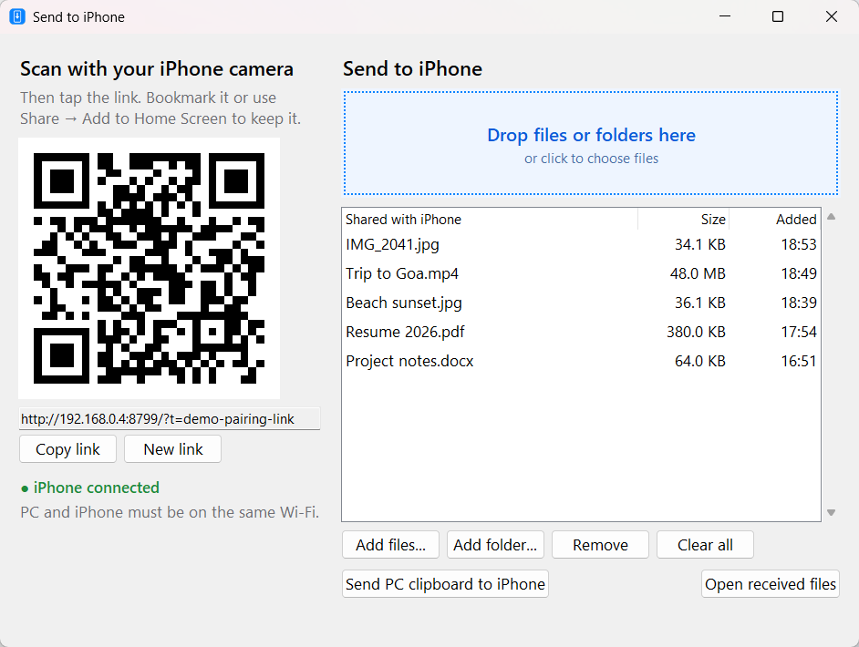
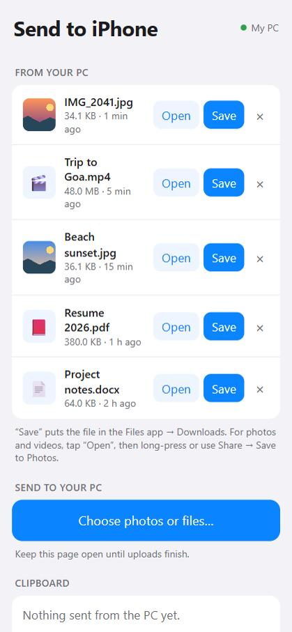
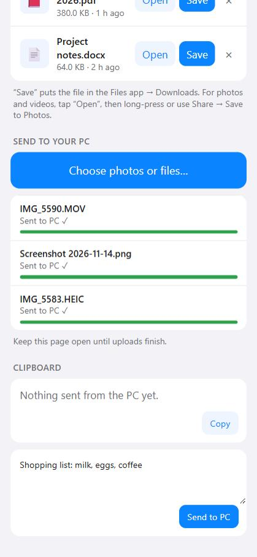

# Send to iPhone

Move files between a Windows PC and an iPhone over Wi-Fi. **Nothing to install on the iPhone.** Scan a QR code once and Safari becomes your transfer page.

## Screenshots

**Windows app**: scan the QR code once, then drag files in (or right-click → Send to iPhone)



<table>
  <tr>
    <td align="center"><b>On the iPhone: files from your PC</b></td>
    <td align="center"><b>Sending photos to the PC + shared clipboard</b></td>
  </tr>
  <tr>
    <td></td>
    <td></td>
  </tr>
</table>

## Features

- **PC → iPhone**: drag files onto the app, or right-click any file or folder in Explorer → **Send to iPhone** (folders are sent as `.zip`)
- **iPhone → PC**: pick photos, videos or files on the phone page and they land in `Downloads\From iPhone`
- **Shared clipboard**: send text either way
- **Tray app**: starts with Windows, with a desktop icon and Start Menu entry
- **Private**: files go straight over your local Wi-Fi, never through the internet. Only phones that scanned your QR code can connect, and "New link" revokes access.
- Large files with progress bars, and resumable/streamable video downloads (HTTP range requests)

## Requirements

- Windows 10/11
- [Python 3.11+](https://www.python.org/downloads/) from python.org
- PC and iPhone on the same Wi-Fi network

## Install

```bash
python install.py
```

This installs to `%LOCALAPPDATA%\Programs\SendToiPhone` (no admin rights needed), adds the desktop/Start Menu shortcuts, the Explorer right-click entry and the startup entry, then starts the app. It runs on Python's signed `pythonw.exe`, so it works with Windows Smart App Control turned on.

The first time it runs, Windows Firewall may ask about Python. Allow **Private networks** so your phone can connect.

Run `python install.py` again to update. To uninstall:

```bash
python install.py --uninstall
```

Files you received are kept.

## Using it

1. Open **Send to iPhone** from the desktop and scan the QR code with the iPhone camera.
2. In Safari, tap **Share → Add to Home Screen** so it opens like an app next time.
3. Send files from either side.

On the iPhone, **Save** stores a file in Files → Downloads. For photos and videos, tap **Open**, then use **Save to Photos**.

## Project layout

| File | What it does |
|---|---|
| `src/main.py` | Tray app, window, single-instance hand-off |
| `src/server.py` | Local HTTP server the phone talks to |
| `src/phone.html` | The page shown on the iPhone |
| `src/core.py` | Settings, shared-file list, helpers |
| `src/wininteg.py` | Right-click menu, startup, shortcuts |
| `src/icon.py` | Draws the app icon |
| `install.py` | Per-user installer / updater / uninstaller |

## Third-party libraries

[pystray](https://github.com/moses-palmer/pystray) (LGPL-3.0), [Pillow](https://python-pillow.org) (MIT-CMU), [qrcode](https://github.com/lincolnloop/python-qrcode) (BSD), [tkinterdnd2](https://github.com/Eliav2/tkinterdnd2) (MIT).

## License

Copyright © 2026. All rights reserved. The source is published for reference only. You may not redistribute or sell it without permission.

*iPhone is a trademark of Apple Inc. This project is not affiliated with Apple.*
